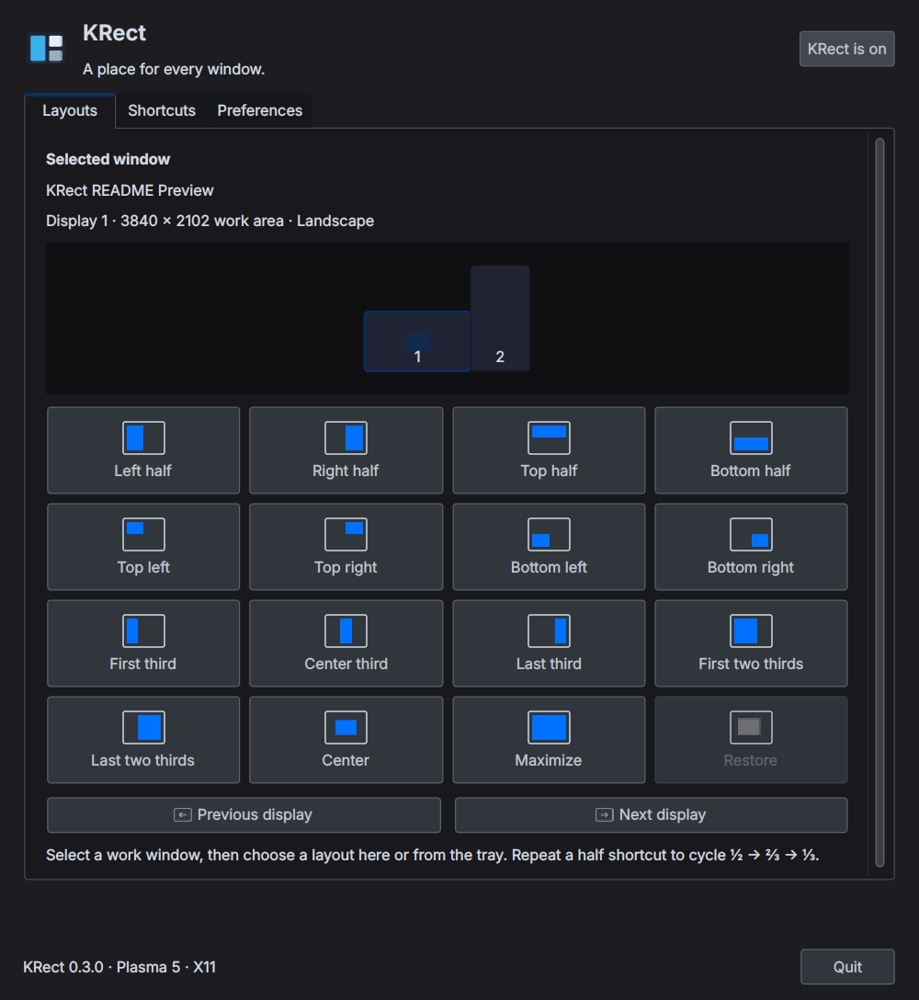

<p align="center">
  
</p>

<h1 align="center">KRect</h1>

<p align="center">
  <a href="https://github.com/ziwon/KRect/releases/latest"></a>
  <a href="https://github.com/ziwon/KRect/releases/latest"></a>
  <a href="docs/VALIDATION.md"></a>
  <a href="LICENSE"></a>
</p>

<p align="center">
  <a href="README.md">한국어</a> · <b>English</b> · <a href="README.ja.md">日本語</a>
</p>

<p align="center">
  <b>A place for every window.</b><br>
  Rectangle-style window management for Ubuntu and Kubuntu KDE.
</p>

<p align="center">
  <a href="https://krect.pages.dev/en/">Website</a> ·
  <a href="https://github.com/ziwon/KRect/releases/tag/v0.3.0">Download v0.3.0</a>
</p>

<p align="center">
  <a href="assets/readme/layouts-0.3.0.png"></a><br>
  <sub>KRect 0.3.0 on Plasma 5.27 / X11. The native app UI supports Korean and English.</sub>
</p>

KRect is a native Qt app that arranges your work windows by dragging or through shortcuts, buttons, and a tray menu.
It works with your existing KWin session, using KDE's work areas and global shortcuts.

## Drag, choose, and drop

**Since 0.3.0, drag a window to the top of a display to arrange it.**

1. Grab the window’s **title bar** and drag it to the **top center** of a display.
2. Move over a region on the snap bar to preview the destination.
3. **Release the mouse** to place the window there.

<p align="center">
  <a href="assets/readme/snap-landscape.png"></a><br>
  <sub>Landscape · halves, thirds, asymmetric thirds, and quarters</sub>
</p>

<p align="center">
  <a href="assets/readme/snap-portrait.png"></a><br>
  <sub>Portrait · thirds and two thirds stack vertically. Both images were captured on Plasma 5.27 / X11.</sub>
</p>

Keep KRect **running in the tray**. Leave the bar to continue a normal drag, or press `Esc` to cancel.
Hovering over a maximize button is not supported.

## Window management that fits KDE

- **Drag to snap** — move a window to the top center of a display, preview a region, and release to place it. Press Esc to cancel.
- **18 actions** — halves, quarters, thirds, two thirds, centering, maximizing, restoring, and moving between displays.
- **Landscape and portrait together** — preview your actual monitor arrangement; thirds stack vertically on portrait displays.
- **Built for KDE** — keep panels clear, edit global shortcuts in the app, and check for conflicts before saving.
- **Your preferences** — set window gaps, exclude apps, and choose whether to start at login. Close the window and keep using the tray.

## Install

A **KDE Plasma session** on Ubuntu or Kubuntu is required. GNOME is not supported.
Check `plasmashell --version`, then choose your package.

| Environment | Download |
| --- | --- |
| Ubuntu 24.04 · Plasma 5.27 · Qt 5 | [.deb for 24.04](https://github.com/ziwon/KRect/releases/download/v0.3.0/krect_0.3.0-1ubuntu24.04_all.deb) |
| Ubuntu 26.04 · Plasma 6 · Qt 6 | [.deb for 26.04](https://github.com/ziwon/KRect/releases/download/v0.3.0/krect_0.3.0-1ubuntu26.04_all.deb) |

Run this in your download folder. On 26.04, substitute the matching filename.

```bash
sudo apt install ./krect_0.3.0-1ubuntu24.04_all.deb
```

This installs the app, launcher, tray, and KWin engine.
If you previously installed from source, quit the app and run `bash uninstall.sh` in that source folder to remove the user installation first.
For an existing system package, quit KRect from the tray, run the command above, and reopen the app.

[All release files and checksums](https://github.com/ziwon/KRect/releases/tag/v0.3.0) · [Source installation guide (Korean)](docs/GUIDE.md#소스에서-설치)

## Get started

1. Find **KRect** in the application launcher or KRunner, open it, and click **Enable KRect**.
2. Drag a window to the **top center of a display** and release over a region, or use a **Layouts** button or the tray menu.
3. Save your preferred keys in **Shortcuts** and adjust gaps and excluded apps in **Preferences**.

KRect remembers your last selected work window and excludes its own window.
Drag layouts need KRect running in the tray. KWin shortcuts keep working after you quit the app. Turn KRect off to stop window actions as well.

## Everyday shortcuts

| Action | Default shortcut |
| --- | --- |
| Left / right half | `Ctrl+Alt+←` / `Ctrl+Alt+→` |
| Top / bottom half | `Ctrl+Alt+↑` / `Ctrl+Alt+↓` |
| Center | `Ctrl+Alt+C` |
| Maximize | `Ctrl+Alt+Enter` |
| Restore original placement | `Ctrl+Alt+Backspace` |
| Previous / next display | `Ctrl+Alt+Shift+←` / `Ctrl+Alt+Shift+→` |

Repeat the same half shortcut within 1.2 seconds to cycle through **½ → ⅔ → ⅓**.
Existing KDE shortcuts are never forcibly overwritten. All 18 actions are listed in the app's **Shortcuts** tab.

## Compatibility

Version 0.3.0 passed **80 automated tests** and **5 live drag-layout scenarios on Plasma 5.27 / X11**.
Package installation, removal, and Qt 5/6 UI construction were also checked in Ubuntu 24.04 and 26.04 containers.
**Live Plasma 6 / Wayland sessions, mixed scaling, physical shortcut input, and login autostart still need validation.**

Maximize-button hover, automatic tiling of all windows, and custom layout presets are not included yet.
An app's minimum size or KWin window rules may affect the resulting window size.
See the [validation record](docs/VALIDATION.md) for coverage and known limits.

## More

- [Advanced guide (Korean)](docs/GUIDE.md) — source installation, full shortcuts, settings, removal, and development
- [Builds and releases](docs/RELEASING.md) · [Plasma 6 upgrade assessment](docs/UPGRADE.md)
- [Report a bug or suggest a feature](https://github.com/ziwon/KRect/issues)

[MIT License](LICENSE). An independent implementation inspired by Rectangle; not an official Rectangle or KDE product.
