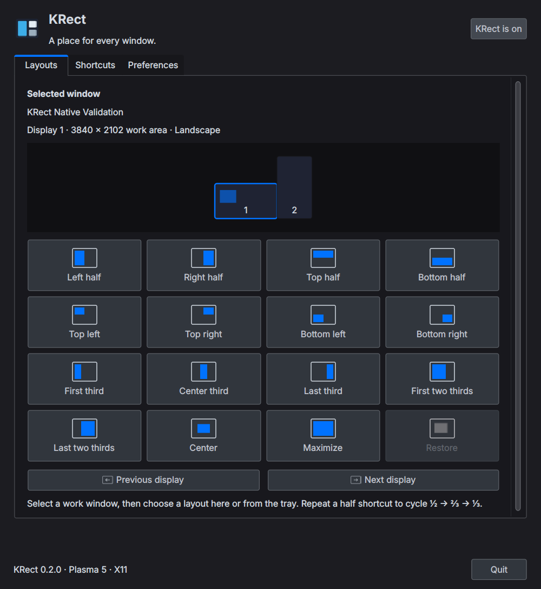

<p align="center">
  
</p>

<h1 align="center">KRect</h1>

<p align="center">
  <a href="README.md">한국어</a> · <b>English</b>
</p>

<p align="center">
  <b>A place for every window.</b><br>
  Rectangle-style window management for Ubuntu and Kubuntu KDE.
</p>

<p align="center">
  <a href="https://github.com/ziwon/KRect/releases/tag/v0.2.0">Download v0.2.0</a> ·
  KDE Plasma 5.27 / 6 ·
  <a href="LICENSE">MIT License</a>
</p>

<p align="center">
  <a href="assets/readme/layouts.png"></a><br>
  <sub>Actual app on Plasma 5.27 / X11. The interface follows your system language: Korean or English.</sub>
</p>

KRect is a native Qt app that arranges your work windows through shortcuts, buttons, and a tray menu.
It works with your existing KWin session, using KDE's work areas and global shortcuts.

## Window management that fits KDE

- **18 actions** — halves, quarters, thirds, two thirds, centering, maximizing, restoring, and moving between displays.
- **Landscape and portrait together** — preview your actual monitor arrangement; thirds stack vertically on portrait displays.
- **Built for KDE** — keep panels clear, edit global shortcuts in the app, and check for conflicts before saving.
- **Your preferences** — set window gaps, exclude apps, and choose whether to start at login. Close the window and keep using the tray.

## Install

A **KDE Plasma session** on Ubuntu or Kubuntu is required. GNOME is not supported.
Check `plasmashell --version`, then choose your package.

| Environment | Download |
| --- | --- |
| Ubuntu 24.04 · Plasma 5.27 · Qt 5 | [.deb for 24.04](https://github.com/ziwon/KRect/releases/download/v0.2.0/krect_0.2.0-1ubuntu24.04_all.deb) |
| Ubuntu 26.04 · Plasma 6 · Qt 6 | [.deb for 26.04](https://github.com/ziwon/KRect/releases/download/v0.2.0/krect_0.2.0-1ubuntu26.04_all.deb) |

Run this in your download folder. On 26.04, substitute the matching filename.

```bash
sudo apt install ./krect_0.2.0-1ubuntu24.04_all.deb
```

This installs the app, launcher, tray, and KWin engine.
If you previously installed from source, quit the app and run `bash uninstall.sh` in that source folder to remove the user installation first.
An existing 0.1.0 system package can be upgraded with the command above.

[All release files and checksums](https://github.com/ziwon/KRect/releases/tag/v0.2.0) · [Source installation guide (Korean)](docs/GUIDE.md#소스에서-설치)

## Get started

1. Find **KRect** in the application launcher or KRunner, open it, and click **Enable KRect**.
2. Select a work window once, then choose a **Layouts** button or an action from the tray menu.
3. Save your preferred keys in **Shortcuts** and adjust gaps and excluded apps in **Preferences**.

KRect remembers your last selected work window and excludes its own window.
KWin shortcuts keep working after you quit the app. Turn KRect off to stop window actions as well.

## Everyday shortcuts

| Action | Default shortcut |
| --- | --- |
| Left / right half | `Ctrl+Alt+←` / `Ctrl+Alt+→` |
| Top / bottom half | `Ctrl+Alt+↑` / `Ctrl+Alt+↓` |
| Center | `Ctrl+Alt+C` |
| Maximize | `Ctrl+Alt+Enter` |
| Restore original placement | `Ctrl+Alt+Backspace` |
| Previous / next display | `Ctrl+Alt+Shift+←` / `Ctrl+Alt+Shift+→` |

Repeat the same half shortcut within 1.2 seconds to cycle through **½ → ⅔ → ⅓**.
Existing KDE shortcuts are never forcibly overwritten. All 18 actions are listed in the app's **Shortcuts** tab.

## Compatibility

Version 0.2.0 passed 63 automated tests and **14 live app checks on Plasma 5.27 / X11**.
Package installation, removal, and Qt 5/6 UI construction were also checked in Ubuntu 24.04 and 26.04 containers.
**Live Plasma 6 / Wayland sessions, mixed scaling, physical shortcut input, and login autostart still need validation.**

Mouse-drag snapping, automatic tiling of all windows, and custom layout presets are not included yet.
An app's minimum size or KWin window rules may affect the resulting window size.
See the [validation record](docs/VALIDATION.md) for coverage and known limits.

## More

- [Advanced guide (Korean)](docs/GUIDE.md) — source installation, full shortcuts, settings, removal, and development
- [Builds and releases](docs/RELEASING.md) · [Plasma 6 upgrade assessment](docs/UPGRADE.md)
- [Report a bug or suggest a feature](https://github.com/ziwon/KRect/issues)

[MIT License](LICENSE). An independent implementation inspired by Rectangle; not an official Rectangle or KDE product.
