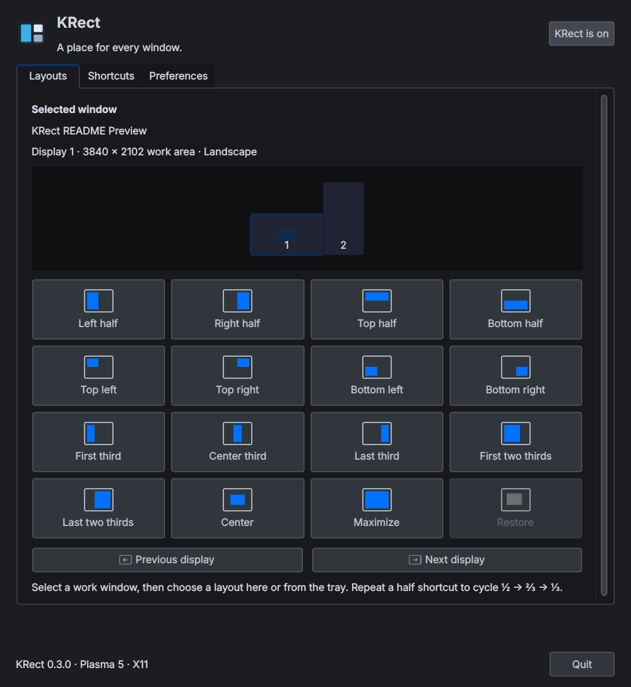
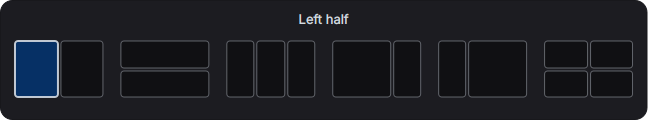
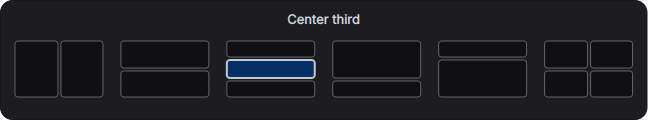

<p align="center">
  
</p>

<h1 align="center">KRect</h1>

<p align="center">
  <a href="https://github.com/ziwon/KRect/releases/latest"></a>
  <a href="https://github.com/ziwon/KRect/releases/latest"></a>
  <a href="docs/VALIDATION.md"></a>
  <a href="LICENSE"></a>
</p>

<p align="center">
  <a href="README.md">한국어</a> · <a href="README.en.md">English</a> · <b>日本語</b>
</p>

<p align="center">
  <b>すべての窓を、思いどおりの場所へ。</b><br>
  Rectangleでおなじみのウィンドウ配置をUbuntu・Kubuntu KDEで。
</p>

<p align="center">
  <a href="https://krect.pages.dev/ja/">ウェブサイト</a> ·
  <a href="https://github.com/ziwon/KRect/releases/tag/v0.3.1">v0.3.1をダウンロード</a>
</p>

<p align="center">
  <a href="assets/readme/layouts-0.3.0.png"></a><br>
  <sub>KRect 0.3.0 · Plasma 5.27 / X11で撮影した実際のアプリ画面。アプリのUIは韓国語・英語に対応しています。</sub>
</p>

KRectは、ドラッグ、ショートカット、ボタン、トレイメニューで作業中のウィンドウを配置するネイティブQtアプリです。
既存のKWin上で動作し、KDEの作業領域とグローバルショートカットを使用します。

**0.3.1 更新:** 配置バーが表示されない、または他のウィンドウに隠れる問題を修正しました。[リリースノート](https://github.com/ziwon/KRect/releases/tag/v0.3.1)

## ドラッグして、選んで、離すだけ

**0.3.0から、ウィンドウを画面上部へドラッグして配置できます。**

1. ウィンドウの**タイトルバー**をつかみ、モニター**上部の中央**へドラッグします。
2. 表示された配置バーの領域に移動し、配置先をプレビューします。
3. **マウスを離すと**、その領域にウィンドウが配置されます。

<p align="center">
  <a href="assets/readme/snap-landscape.png"></a><br>
  <sub>横向き画面 · 2分割、3分割、非対称の⅓・⅔配置、4分割</sub>
</p>

<p align="center">
  <a href="assets/readme/snap-portrait.png"></a><br>
  <sub>縦向き画面 · ⅓・⅔の領域が上下に並びます。どちらもPlasma 5.27 / X11で撮影しました。</sub>
</p>

KRectを**トレイで起動しておいてください**。バーの外に移動すれば通常のドラッグを続けられ、`Esc`でキャンセルできます。
最大化ボタンへのホバーには対応していません。

## KDEで快適にウィンドウを整理

- **ドラッグ配置** — ウィンドウをモニター上部の中央へドラッグし、プレビューで領域を選んで離します。Escでキャンセルできます。
- **18の操作** — 半分、4分割、⅓・⅔配置、中央揃え、最大化、元の配置への復元、モニター間の移動。
- **横向き・縦向きモニターを併用** — 実際のモニター配置をプレビュー。縦向き画面では3分割が上下に並びます。
- **KDEに馴染む操作** — パネルを避けて配置し、アプリでショートカットを編集。保存前に競合を確認できます。
- **自分に合った設定** — ウィンドウ間の余白、除外するアプリ、ログイン時の起動を設定。アプリのウィンドウを閉じてもトレイで使えます。

## インストール

Ubuntu・Kubuntuの**KDE Plasmaセッション**が必要です。GNOMEには対応していません。
`plasmashell --version`でバージョンを確認してから、パッケージを選んでください。

| 環境 | ダウンロード |
| --- | --- |
| Ubuntu 24.04 · Plasma 5.27 · Qt 5 | [24.04用.deb](https://github.com/ziwon/KRect/releases/download/v0.3.1/krect_0.3.1-1ubuntu24.04_all.deb) |
| Ubuntu 26.04 · Plasma 6 · Qt 6 | [26.04用.deb](https://github.com/ziwon/KRect/releases/download/v0.3.1/krect_0.3.1-1ubuntu26.04_all.deb) |

ダウンロードしたフォルダーで実行します。26.04では対応するファイル名に置き換えてください。

```bash
sudo apt install ./krect_0.3.1-1ubuntu24.04_all.deb
```

アプリ、ランチャー、トレイ、KWinエンジンがインストールされます。
ソースからインストールしていた場合は、アプリを終了し、ソースフォルダーの`bash uninstall.sh`でユーザー用コピーを先に削除してください。
既存のシステムパッケージを更新する場合は、トレイからKRectを終了して上のコマンドを実行し、アプリを開き直してください。

[全リリースファイルとチェックサム](https://github.com/ziwon/KRect/releases/tag/v0.3.1) · [ソースからのインストールガイド（韓国語）](docs/GUIDE.md#소스에서-설치)

## 使い始める

1. アプリランチャーやKRunnerで**KRect**を開き、**Enable KRect**を押します。
2. ウィンドウを**モニター上部の中央**へドラッグし、配置バーの領域で離します。**Layouts**のボタンやトレイメニューも使えます。
3. **Shortcuts**でキーを保存し、**Preferences**で余白や除外するアプリを設定します。

KRectは最後に選択した作業ウィンドウを記憶し、自身のウィンドウは配置対象から除外します。
ドラッグ配置にはKRectがトレイで起動している必要があります。アプリを終了してもKWinのショートカットは動作します。
配置機能自体を停止するには、アプリでKRectを無効にしてください。

## よく使うショートカット

| 操作 | 初期設定のキー |
| --- | --- |
| 左半分 / 右半分 | `Ctrl+Alt+←` / `Ctrl+Alt+→` |
| 上半分 / 下半分 | `Ctrl+Alt+↑` / `Ctrl+Alt+↓` |
| 中央揃え | `Ctrl+Alt+C` |
| 最大化 | `Ctrl+Alt+Enter` |
| 元の配置を復元 | `Ctrl+Alt+Backspace` |
| 前 / 次のモニター | `Ctrl+Alt+Shift+←` / `Ctrl+Alt+Shift+→` |

同じ半分配置のショートカットを1.2秒以内に繰り返すと、**½ → ⅔ → ⅓**と切り替わります。
既存のKDEショートカットを強制的に上書きしません。18の操作はアプリの**Shortcuts**タブで確認できます。

## 対応環境と検証範囲

0.3.1は**82の自動テスト**と、**Plasma 5.27 / X11のドラッグ配置に関する6つの実機シナリオ**を通過しました。
Ubuntu 24.04・26.04のコンテナーで、パッケージのインストール・削除とQt 5/6のUI生成も確認しています。
**Plasma 6 / Waylandの実機、異なる表示倍率の併用、物理キー入力、ログイン時の自動起動は追加検証が必要です。**

最大化ボタンへのホバー、すべてのウィンドウの自動タイリング、カスタムレイアウトのプリセットはまだ提供していません。
アプリの最小サイズやKWinのウィンドウルールによって、実際の配置サイズが異なる場合があります。
[検証記録（英語）](docs/VALIDATION.md)もご確認ください。

## 関連リンク

- [詳細ガイド（韓国語）](docs/GUIDE.md) — ソースインストール、全ショートカット、設定、削除、開発方法
- [ビルドとリリース（英語）](docs/RELEASING.md) · [Plasma 6へのアップグレード検討](docs/UPGRADE.md)
- [バグ報告・機能提案](https://github.com/ziwon/KRect/issues)

[MIT License](LICENSE)。Rectangleに着想を得た独立した実装であり、RectangleやKDEの公式製品ではありません。
