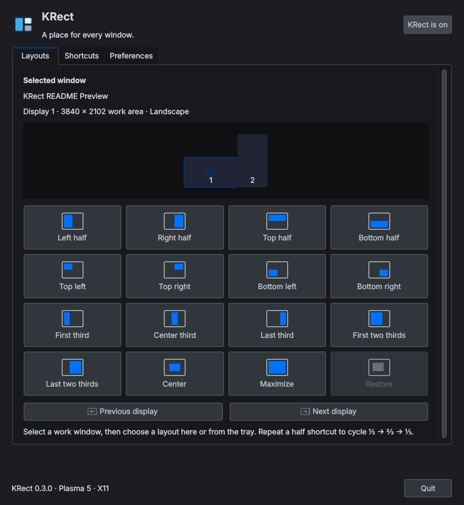

<p align="center">
  
</p>

<h1 align="center">KRect</h1>

<p align="center">
  <a href="https://github.com/ziwon/KRect/releases/latest"></a>
  <a href="https://github.com/ziwon/KRect/releases/latest"></a>
  <a href="docs/VALIDATION.md"></a>
  <a href="LICENSE"></a>
</p>

<p align="center">
  <b>한국어</b> · <a href="README.en.md">English</a> · <a href="README.ja.md">日本語</a>
</p>

<p align="center">
  <b>모든 창을, 원하는 자리에.</b><br>
  Rectangle의 익숙한 창 배치를 Ubuntu·Kubuntu KDE에서.
</p>

<p align="center">
  <a href="https://krect.pages.dev/">웹사이트</a> ·
  <a href="https://github.com/ziwon/KRect/releases/tag/v0.3.1">v0.3.1 다운로드</a>
</p>

<p align="center">
  <a href="assets/readme/layouts-0.3.0.png"></a><br>
  <sub>KRect 0.3.0 · Plasma 5.27 / X11의 실제 앱 화면. 앱 UI는 한국어·영어를 지원합니다.</sub>
</p>

KRect는 드래그, 단축키, 앱 버튼, 트레이 메뉴로 작업 중인 창을 배치하는 네이티브 Qt 앱입니다.
기존 KWin 위에서 동작하며 KDE의 작업 영역과 전역 단축키를 사용합니다.

**0.3.1 업데이트:** 배치 막대가 숨거나 다른 창 뒤에 가려지는 문제를 수정했습니다. [릴리즈 노트](https://github.com/ziwon/KRect/releases/tag/v0.3.1)

**프리릴리즈 [0.4.0-rc.2](https://github.com/ziwon/KRect/releases/tag/v0.4.0-rc.2):** 데스크톱별 작업 공간 저장·복원과 시작 시 자동 복원, 두 창 교환·되돌리기를 추가했습니다. 작업 공간 복원은 Plasma 5.27/X11 듀얼 모니터에서 검증했습니다. 안정판은 0.3.1이며, 실제 재로그인·앱 자동 실행·창 교환과 Plasma 6/Wayland 실기는 아직 검증하지 않았습니다.

## 끌어서 고르고, 놓으면 끝

**0.3.0부터 창을 화면 상단으로 끌어 배치할 수 있습니다.**

1. 창의 **제목 표시줄**을 잡고 모니터 **상단 중앙**으로 끕니다.
2. 나타난 배치 막대에서 원하는 영역으로 이동해 위치를 미리 봅니다.
3. **마우스를 놓으면** 그 영역에 창이 배치됩니다.

<p align="center">
  <a href="assets/readme/snap-landscape.png"></a><br>
  <sub>가로 화면 · 2분할, 3분할, 비대칭 ⅓·⅔, 4분할</sub>
</p>

<p align="center">
  <a href="assets/readme/snap-portrait.png"></a><br>
  <sub>세로 화면 · ⅓·⅔ 배치가 위아래로 전환됩니다. 두 이미지 모두 Plasma 5.27 / X11에서 촬영했습니다.</sub>
</p>

KRect를 **트레이에서 실행해 두세요**. 막대를 벗어나면 일반 드래그를 계속하고, `Esc`로 취소할 수 있습니다.
최대화 버튼에 마우스를 올리는 방식은 지원하지 않습니다.

## KDE에서 편하게 창 정리

- **드래그 배치** — 창을 화면 상단 중앙으로 끌고, 미리보기에서 원하는 영역을 골라 놓으세요. Esc로 취소할 수 있습니다.
- **18가지 동작** — 반쪽·4분할·⅓·⅔ 배치, 중앙 정렬, 최대화, 원래 배치 복원과 모니터 이동.
- **가로·세로 모니터 함께** — 실제 모니터 위치를 미리 보고, 세로 화면의 3분할은 위아래로 배치합니다.
- **KDE와 자연스럽게** — 패널을 피해서 배치하고, 앱에서 전역 단축키를 편집하며 충돌을 확인합니다.
- **내 작업 방식에 맞게** — 창 간격, 제외할 앱, 로그인 시 실행을 설정합니다. 창을 닫아도 트레이에서 사용할 수 있습니다.

## 설치

Ubuntu·Kubuntu의 **KDE Plasma 세션**이 필요합니다. GNOME에서는 동작하지 않습니다.
`plasmashell --version`으로 버전을 확인한 뒤 설치 파일을 선택하세요.

| 환경 | 다운로드 |
| --- | --- |
| Ubuntu 24.04 · Plasma 5.27 · Qt 5 | [24.04용 .deb](https://github.com/ziwon/KRect/releases/download/v0.3.1/krect_0.3.1-1ubuntu24.04_all.deb) |
| Ubuntu 26.04 · Plasma 6 · Qt 6 | [26.04용 .deb](https://github.com/ziwon/KRect/releases/download/v0.3.1/krect_0.3.1-1ubuntu26.04_all.deb) |

다운로드한 폴더에서 실행하세요. 26.04에서는 해당 파일명으로 바꿉니다.

```bash
sudo apt install ./krect_0.3.1-1ubuntu24.04_all.deb
```

앱, 실행기, 트레이와 KWin 엔진을 함께 설치합니다.
기존에 소스로 설치했다면 앱을 종료하고 소스 폴더에서 `bash uninstall.sh`로 사용자 설치를 제거한 뒤 진행하세요.
기존 시스템 패키지는 트레이 메뉴에서 KRect를 종료한 뒤 위 명령으로 업데이트하고 앱을 다시 실행하세요.

[소스 설치·업데이트·제거](docs/GUIDE.md#소스에서-설치) · [전체 릴리즈 파일과 체크섬](https://github.com/ziwon/KRect/releases/tag/v0.3.1)

## 시작하기

1. 앱 실행기나 KRunner에서 **KRect**를 찾아 열고 **KRect 켜기**를 누르세요.
2. 창을 **모니터 상단 중앙**으로 끌어 배치 영역에서 놓거나, KRect의 **창 배치** 버튼과 트레이 메뉴를 사용하세요.
3. **단축키**에서 원하는 키를 저장하고, **환경설정**에서 간격과 제외 앱을 조정하세요.

KRect는 마지막으로 선택한 작업 창을 기억합니다. KRect 자신의 창은 배치 대상에서 제외합니다.
드래그 배치는 KRect가 트레이에서 실행 중일 때 작동합니다. 앱을 종료해도 KWin 단축키는 계속 작동합니다. 배치 기능까지 멈추려면 KRect를 끄세요.

## 자주 쓰는 단축키

| 동작 | 기본 단축키 |
| --- | --- |
| 왼쪽 / 오른쪽 반쪽 | `Ctrl+Alt+←` / `Ctrl+Alt+→` |
| 위 / 아래 반쪽 | `Ctrl+Alt+↑` / `Ctrl+Alt+↓` |
| 중앙 정렬 | `Ctrl+Alt+C` |
| 최대화 | `Ctrl+Alt+Enter` |
| 원래 배치 복원 | `Ctrl+Alt+Backspace` |
| 이전 / 다음 모니터 | `Ctrl+Alt+Shift+←` / `Ctrl+Alt+Shift+→` |

같은 반쪽 단축키를 1.2초 안에 반복하면 **½ → ⅔ → ⅓**로 순환합니다.
기존 KDE 단축키는 강제로 덮어쓰지 않습니다. [전체 단축키와 설정](docs/GUIDE.md#기본-단축키)을 확인하세요.

## 지원 범위

0.3.1은 자동 테스트 **82개**와 **Plasma 5.27 / X11의 드래그 배치 실기 6개 시나리오**를 통과했습니다.
Ubuntu 24.04·26.04 컨테이너에서 패키지 설치·제거와 Qt 5/6 화면 생성도 확인했습니다.
**Plasma 6 / Wayland 실기, 혼합 배율, 물리 단축키 입력과 로그인 자동 시작은 추가 검증이 필요합니다.**

최대화 버튼 호버, 모든 창의 자동 타일링, 사용자 지정 배치 프리셋은 아직 제공하지 않습니다.
앱의 최소 크기나 KWin 창 규칙에 따라 실제 배치 크기가 달라질 수 있습니다.
[검증 기록](docs/VALIDATION.md)과 [세부 동작·제약](docs/GUIDE.md#실제-환경에서-확인할-부분)을 참고하세요.

## 더 알아보기

- [사용 가이드](docs/GUIDE.md) — 소스 설치, 전체 단축키, 설정, 제거와 개발 방법
- [빌드·릴리즈](docs/RELEASING.md) · [Plasma 6 업그레이드 검토](docs/UPGRADE.md)
- [버그 신고·제안](https://github.com/ziwon/KRect/issues)

[MIT License](LICENSE). Rectangle에서 영감을 받은 독립 구현이며, Rectangle이나 KDE의 공식 제품은 아닙니다.
